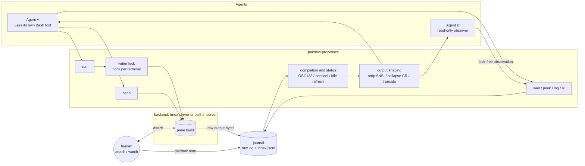

# Concepts

This page is for engineers evaluating the design. It explains *why* pairmux is built the way it is, not just what it does.

pairmux is deliberately **not** a new terminal emulator, and it installs no background service to
own terminal state. A multiplexer owns the live panes — tmux when it is installed, otherwise a small
built-in server that starts on demand and exits on its own — and pairmux adds completion outcomes,
captured journal output, model-friendly views, and a per-terminal `run` writer discipline around the
same live pane. See [Terminal backends](#terminal-backends) for how the two are chosen.

:::info Not yet released
The built-in backend and native Windows support ship in the next release after v0.6.0. v0.6.0 and
earlier always use tmux.
:::

## Architecture



Terminal operations such as `run` and `wait` are ordinary processes that poll the journal until their condition is met, then exit. `watch` and `mcp serve` intentionally remain in the foreground for the lifetime of that dashboard or MCP client connection. pairmux installs no background daemon: tmux keeps its normal server, and the built-in server is started on demand and exits when idle. Durable state lives in two places: per-pane metadata held by the backend (tmux pane user-options on the tmux backend), which lives and dies with the pane, and a socket-specific journal namespace under the configured state root.

## Terminal backends

Something has to own a live terminal between pairmux's short-lived commands. pairmux has two
backends with the same commands, envelopes, and journals.

**tmux** (tmux >= 3.2) already maintains screen rendering, scrollback, and — crucially — lets a
human `attach`. On this backend pairmux leans on all of it instead of reimplementing it: it invokes
tmux operations such as `new-window`, `send-keys -l`, `pipe-pane`, `capture-pane`, and pane options,
while journal metadata stays in ordinary files. `pairmux attach` replaces itself with a tmux client
against the configured pairmux socket and session, and `peek --screen` requests a `capture-pane`
render, so the human and agent observe the same real pane with tmux's familiar attach and detach
workflow.

**builtin** is pairmux's own small server for machines without tmux, and the only backend on
Windows. It allocates real PTYs through `/dev/ptmx` on macOS/Linux and ConPTY on Windows. The server
is the same `pairmux` executable running a hidden subcommand; the first command that needs it starts
it, detached from the caller's session or console. There is one server per endpoint (the `--socket`
/ `PAIRMUX_SOCKET` name), and it exits by itself after about 30 seconds with no terminals and no
connections — so there is still no service to install, supervise, or stop. It keeps a virtual screen
so `peek --screen` has tmux `capture-pane -p` semantics, journals a program's output from its very
first byte, and defaults to tmux's 220x50 size. `attach` connects the human's terminal straight to
the pane (see [human collaboration](./guides/human-collaboration.md#the-three-human-commands)).

Either way, attaching does not transfer exclusive ownership; a human leaves a `note` as the explicit
hand-back signal. `E_TMUX` keeps its historical name but means the backend — tmux or the built-in
server — failed; built-in failures carry built-in-specific hints.

### Choosing a backend

`PAIRMUX_BACKEND` selects `tmux`, `builtin`, or `auto` (the same as unset). The automatic choice is
made per endpoint, so it is stable across the many short pairmux processes that address one set of
terminals:

1. Windows → `builtin`. `PAIRMUX_BACKEND=tmux` on Windows is an error.
2. A built-in server is already running for this socket → `builtin`. Terminals created before tmux
   was installed stay reachable afterwards — unless a tmux server is running for the same socket
   too, in which case `tmux` keeps its live terminals visible.
3. tmux 3.2 or newer is on PATH → `tmux`. Existing users see no change, and their live tmux
   terminals stay where they are. An older tmux is skipped in favor of `builtin`.
4. Otherwise → `builtin`.

Every terminal is created with `PAIRMUX_BACKEND` set to its own backend, so a nested pairmux layer
started inside it lands on the same backend. An invalid value is an `E_BAD_ARGS` error for terminal
commands, while `help`, `version`, `doctor`, `skill`, and `update` still work. `pairmux doctor`
reports the choice and the reason on its first line.

### The built-in runtime directory

The built-in server keeps its socket (`<socket>.sock`), single-instance lock (`<socket>.lock`), and
diagnostic log (`<socket>.log`) in a per-user runtime directory:

| Platform | Directory |
| --- | --- |
| macOS/Linux | `$PAIRMUX_TMPDIR`, else `$TMUX_TMPDIR`, else `/tmp`, then `pairmux-<uid>/` |
| Windows | `%PAIRMUX_TMPDIR%`, else `%LOCALAPPDATA%\pairmux`, then `run\` |

On Unix the directory is created with mode 0700 and refused if another uid owns it or if group or
others can access it, because anyone who can reach the socket can type into your terminals. Clients
check it before every connection too, as tmux does: a socket in a directory someone else prepared
would receive your environment and keystrokes. On Windows the directory is created with an ACL
admitting only you and SYSTEM (so even a `PAIRMUX_TMPDIR` on a shared drive stays private) and is
refused if another account owns it. A server that exits cleanly removes its socket, lock and log. Socket
paths are limited to about 100 bytes: an overly long socket name gets a digest name instead,
and a directory that is itself too deep fails with a hint to set `PAIRMUX_TMPDIR` to a short writable
directory. On Windows the server runs from a private copy, `pairmux-muxd-<hash>.exe`, in this
directory, so an upgrade can replace the installed `pairmux.exe` while terminals are open.

## The journal: single source of truth

When a terminal is created, the pane's **raw output bytes** stream into a journal: on tmux through `tmux pipe-pane`, on the built-in backend from the server itself, starting with the program's very first byte. The screen render (`capture-pane`, or the built-in virtual screen) is demoted to an auxiliary "what does the screen look like right now" view.

```text
<state-root>/              # PAIRMUX_STATE_DIR, else $XDG_STATE_HOME/pairmux,
                           # else ~/.local/state/pairmux
  .sockets/<sha256(endpoint identity)>/
    <terminal>/
      raw.log       # raw output bytes (mode 0600)
      index.jsonl   # {ts, type, cmd_id, offset, exit_code?, text?} — one event per line
                    # type: created | cmd_start | cmd_end | note | sent
      meta.json     # name, pane id, shell, mode, socket
```

The journal is what makes three otherwise-hard problems easy:

- **Truncation is never silent.** A shaped command reply carries `head` + `tail` plus a
  `truncated.get_full` command. Bounded recent views also report the raw prefix as
  `omitted_bytes` and point to `pairmux log <name> --range 1:end`.
- **Scrolled-off output is still there.** Explicit `pairmux log --grep`/`--range`/`--cmd` requests
  query the complete selected history, not the viewport or only the recent byte window.
- **Multi-agent reads are lock-free.** Reading a file needs no coordination, so any number of agents can watch the same terminal (for example, several agents tailing one dev-server's log).

`run` captures a command's output by recording the journal byte-offset when it sends the command (`cmd_start`) and the offset of the completion mark (`cmd_end`), then shaping the bytes between them.

`sent` records that `send` delivered input, and deliberately records only its shape (`text+enter`)
and never its content — a human answering a handoff types the credential through `send`, and this
file outlives the screen. It exists so a note can be marked answered on a terminal that completes
no commands: see [human collaboration](./guides/human-collaboration.md).

## The blocking CLI as the "poke"

For a tmux endpoint, the endpoint identity includes the canonical `TMUX_TMPDIR`, uid, and tmux
socket label. Built-in endpoints hash a separate identity, so they get their own namespace and a
terminal called `build` on each backend never collides. Hashing keeps paths bounded and prevents
equal terminal names on different servers from sharing metadata. Each backend lists only its own
terminals, live or dead. Conventional default-endpoint tmux journals from older releases remain
readable in `<root>/<terminal>/` without an implicit move; that fallback is tmux-only. Legacy
custom-socket metadata is not claimed because it lacks enough information to attribute it to a full
endpoint safely.

The timing problem — *when should the agent read the output?* — is solved without any push channel. The insight: an agent's shell tool call is **already blocking**. So pairmux makes the CLI block:

> `pairmux run` polls for a completion mark or quiet recognized prompt until its timeout. `pairmux
> wait` polls for the requested idle, pattern, or human-note condition and refreshes pane liveness;
> it also returns when the pane dies or its timeout fires.

The agent does not need an external `sleep` loop to sample output. Polling and quiescence detection
live inside the CLI, while the caller chooses explicit blocking deadlines. A `run` timeout is not a
failure: it returns `status: running` with the current tail and a `next` step. A `wait` timeout returns
`status: timeout` and another bounded wait hint. Pattern waits intentionally scan only bytes appended
after that wait begins; use `log --grep` for earlier output and arm a waiter before an event when
gap-free observation matters.

## Completion detection and the idle backstop

Knowing a command *finished* (and its exit code) drives everything. Terminals store one of two
completion modes; idle waiting is a separate status backstop:

1. **OSC 133 shell integration (primary).** `new` launches bash with `--rcfile` and zsh through a
   `ZDOTDIR` shim. Fish 4+ emits compatible marks natively, so pairmux launches the selected fish
   binary without replacing the user's configuration. PowerShell gets an inline prompt wrapper (see
   [Windows](#windows)). The journal scanner accepts both BEL- and ST-terminated OSC 133
   `A`/`B`/`C`/`D` marks, including fish's attributes; `D` carries the exit code. Terminals using
   this path report `mode: hooks`.
2. **Sentinel (interactive-shell fallback).** Unknown interactive shells, and `cmd.exe`, use a
   nonprinting OSC marker for commands sent by `run`. A nominal hooks shell that emits no ready mark
   also degrades to this mode. POSIX-like shells insert the previous status through `$?`; fish uses
   `$status`; `cmd.exe` uses `ERRORLEVEL`. These terminals report `mode: sentinel`.
3. **Quiescence plus state refresh (status backstop).** `wait --idle` first observes output silence,
   then refreshes liveness and completion state. Silence is not itself completion: a quiet but
   still-running command keeps waiting; a prompt returns `awaiting-input`, and only an actually idle
   shell returns `idle`.

Program terminals created with `new --cmd` also store `mode: sentinel` for the two-value envelope
schema, but they do not accept `run` and pairmux does not append per-command completion markers to
them. They are driven with `send`/`wait`/`peek`; their base state is `running` while the pane exists
and `dead` after it exits, while a recognized quiet prompt can refine an observation to
`awaiting-input`.

`pairmux doctor` reports the diagnostic tier each shell actually reaches, including `hooks-no-C` —
bash 3.2 and pairmux's PowerShell wrapper emit `A`/`D` but never the `C` (output-start) mark, so
completion detection works but human-interleave correlation is slightly weaker. `hooks-no-C` is not a stored mode: the terminal still
reports `hooks`. With full hooks, completion is correlated to *pairmux's own* command marks, so a human
typing commands in the same pane cannot spoof a completion.

## Bounded and explicit reads

The current raw journal is retained, but routine observation is deliberately bounded: `peek` reads
the final 64 KiB before applying its line limit, while default `log` reads the final 4 MiB and returns
the last 500 shaped lines. A byte-capped response carries the exact skipped prefix as
`truncated.omitted_bytes`; `omitted_lines` describes line shaping within the bytes actually read.
Its recovery command is executable: `pairmux log <name> --range 1:end`.

Explicit `log --cmd N`, `--grep RE`, and `--range A:B`/`A:end` requests read the complete selected
history. They can produce large replies by design, because the selector is the caller's explicit opt-in.

### awaiting-input detection

Separately, pairmux watches for a command that has gone **quiet with a prompt-shaped last line** — `[y/N]`, `password:`, a pager's `--More--`/`(END)`, "press any key". This refines `running` into the `awaiting-input` status. It is surfaced as a status only; pairmux never auto-answers.

Secret-shaped prompts — password/passphrase/passcode, PIN, OTP/MFA/verification codes, API keys,
tokens, and the standard sudo password translations for common locales — are classified as
**secrets**. Instead of a "send this answer" hint, the reply says `do NOT guess or type secrets` and
points at human handoff (`wait --human --notify`, which ends on a note or once the prompt is
answered). The secret verdict comes from the pane's line discipline — echo suppressed while the
kernel still assembles a line is what `getpass()` does, so it identifies a credential prompt in any
language and from any tool, including ones no pattern covers. Windows has no tty line discipline to
read, so there the wording is the only evidence. Phrasing is a second source, and a
terminal that merely goes quiet mid-line for ten seconds is reported as an unrecognized prompt so
an unusual question still surfaces. Recognition of *wording* remains best-effort: a missed prompt
leaves the terminal `running` (never an auto-answer), and `PAIRMUX_SECRET_PROMPT_RE` extends the
patterns for your environment. See [human collaboration](./guides/human-collaboration.md).

## Self-teaching output

Agents cannot be assumed to retain every documentation detail, so actionable replies embed an ordered `next`
list. Entries may be safety instructions, placeholders, or commands: obey them in order, substitute
real values, then execute the first applicable command. Truncated output ships `get_full`; an awaiting-input reply ships a `send` example (or
the secret-handoff rule); a busy terminal reports who holds the lock. The skill teaches the workflow;
the reply teaches the next step.

## Concurrency and locking

- **Reads** (`peek`, `log`, `ls`, `wait`) are lock-free and record nothing.
- **Command writes** (`run`) take a per-terminal `flock`. When it is contended, pairmux returns an
  `E_BUSY` envelope immediately, naming the holder's pid — it does not queue.
- **Interactive input** (`send`) intentionally bypasses that lock so it can answer a program while
  the corresponding `run` call is blocked. This does not enforce ownership; callers should send each
  answer once and then observe with `wait`/`peek`.
- **Creation** uses a separate per-name reservation, so concurrent `new --name X` calls create exactly
  one pane.
- **Humans** type through `attach` (a native tmux client, or the built-in direct attach) and bypass
  locks; `send` warns the agent when a human is attached. A `note` is journaled; attaching alone is
  not an event, so the human leaves a note when handing control back.

## Windows

On Windows (10 1809 or newer, x86-64 or ARM64) pairmux always uses the built-in backend over
ConPTY; neither tmux nor WSL is needed. This support is new: it is validated by CI on hosted Windows Server 2025
runners, has not been accepted on real Windows hardware, and the ARM64 build has not been
exercised at runtime. WSL remains possible: inside it, pairmux is a Linux program and chooses its
backend as on Linux.

- **Shell.** A new terminal starts PowerShell 7 (`pwsh.exe`), else Windows PowerShell
  (`powershell.exe`), else `%COMSPEC%` (normally `cmd.exe`). `$SHELL` is honored only if it names an
  existing file — Git Bash exports `/usr/bin/bash`, which Windows cannot start. `PAIRMUX_SHELL`
  overrides the shell on every platform, e.g. `PAIRMUX_SHELL=C:\Program Files\Git\bin\bash.exe`.
- **Completion.** PowerShell terminals use `hooks` mode: after the user's profile loads, an inline
  prompt wrapper emits OSC 133 `A`/`D` marks with the exit status (`$?`/`$LASTEXITCODE`). It is
  passed with `-NoExit -EncodedCommand`, so the script execution policy does not apply to it, and it
  emits no `C` mark, so `doctor` reports `hooks-no-C`. `cmd.exe` uses `sentinel` mode
  (`cmd /v:on /k`, exit status from `ERRORLEVEL`). Git Bash gets the same bash hooks shim as on Unix.
- **Program terminals.** `new --cmd` runs its command through the shell: PowerShell
  `-EncodedCommand`, `cmd /s /c`, or `bash -lc`.
- **Secret prompts.** There is no tty line discipline to read, so classification uses prompt wording
  only; `PAIRMUX_SECRET_PROMPT_RE` can extend it.
- **Process lifetime.** `kill` ends the terminal's whole process tree through a job object.
- **Notifications and updates.** `--notify` shows a best-effort notification through Windows
  PowerShell. `pairmux update` refuses with `E_UPDATE` (see the
  [CLI reference](./cli-reference.md#update-v060)).

## Statuses and modes

The full status and mode tables live in the [CLI Reference](./cli-reference.md#statuses). In short: a terminal is `idle` / `running` / `awaiting-input` / `dead`, with transient `unknown` when a live state cannot yet be derived confidently. Each terminal stores `hooks` or `sentinel`; for `--cmd` program terminals, `sentinel` is a schema label rather than evidence that pairmux injects per-command markers.
